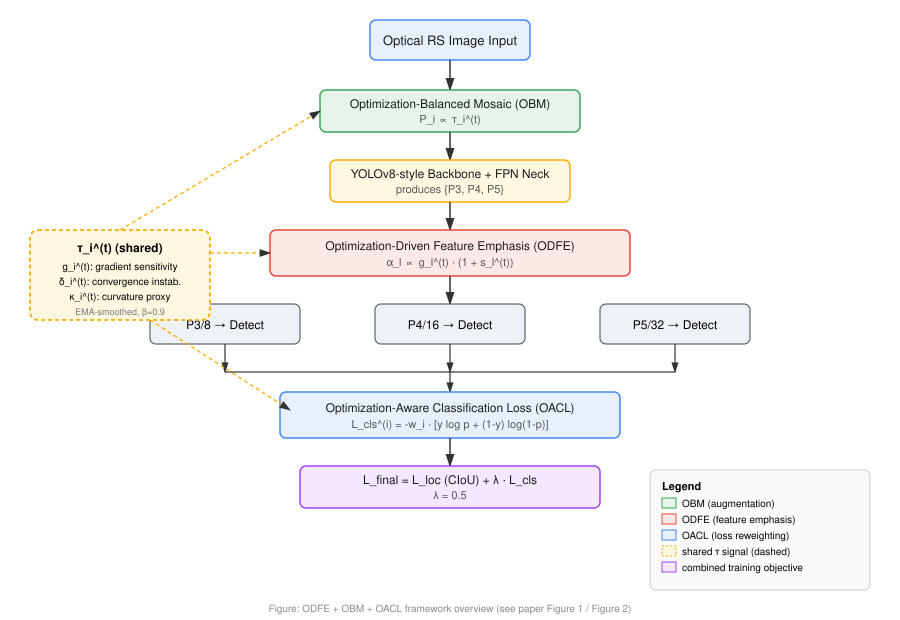

# ODFE + OBM + OACL

### Optimization-Driven Feature Learning for Long-Tailed Object Detection in Optical Remote Sensing Imagery

[](https://github.com/nishimaliknitj/ODFE-OBM-OACL-RSDetection/actions)
[](LICENSE)
[](https://www.python.org/downloads/)
[](https://pytorch.org/)

Official implementation of **"Optimization-Driven Feature Learning for Long-Tailed Object Detection in Optical Remote Sensing Imagery"**.

> Nishi Madaan, Rahul Malik, Utsav Upadhyay, Alok Kumar, Satyabrata Roy, Umashankar Rawat
> School of Computer Science and Engineering, Galgotias University, Greater Noida, India
> Department of Computer Science and Engineering, Manipal University Jaipur, Jaipur, India

---

## Overview

Long-tailed class distributions are a fundamental bottleneck in optical remote sensing object detection. Existing methods treat this purely as a **class-frequency** problem (data rebalancing, loss reweighting by rarity, classifier decoupling). This repository implements a complementary perspective: long-tailed performance degradation is driven primarily by **optimization difficulty** — unstable gradients, slow convergence, and non-convex loss landscapes for small, densely distributed, background-cluttered objects — regardless of how frequent their class is.

We introduce a **single, shared, EMA-smoothed optimization difficulty score** `τ_i^(t)`, computed per-sample from three complementary signals, which simultaneously drives three modules:

| Signal | Symbol | Meaning |
|---|---|---|
| Gradient sensitivity | `g_i^(t)` | Expected gradient magnitude of the detection loss w.r.t. features |
| Convergence instability | `δ_i^(t)` | Absolute change in per-sample loss between consecutive iterations |
| Curvature proxy | `κ_i^(t)` | Temporal variation of gradient magnitude (first-order curvature proxy) |

```
τ_i^(t) = g_i^(t) · (1 + δ_i^(t) + κ_i^(t))          (EMA-smoothed, β = 0.9)
```

| Module | Full name | Role |
|---|---|---|
| **ODFE** | Optimization-Driven Feature Emphasis | Reweights multi-scale (P3/P4/P5) feature pyramid levels by `α_l ∝ g_l · (1 + s_l)` |
| **OBM** | Optimization-Balanced Mosaic | Sets per-sample mosaic augmentation probability `P_i ∝ τ_i^(t)` |
| **OACL** | Optimization-Aware Classification Loss | Reweights per-sample BCE classification loss by `w_i ∝ τ_i^(t) / E[τ^(t)]` (bounded by `w_max`) |

The three modules are jointly optimized under:

```
L_final = L_loc (CIoU) + λ · L_cls (OACL)          λ = 0.5
```

with an optional invariance regularization term `L_inv` between ODFE feature maps of two augmented views of the same image.

<p align="center">
  
</p>

---

> **Reviewers / Editors**: For reproducibility documentation (code + dataset availability statement), see [`DATA_AVAILABILITY.md`](DATA_AVAILABILITY.md).

## Key Results

| Dataset | Baseline (YOLOv8) | + ODFE | + ODFE + OBM | **Full Model** | Gain |
|---|---|---|---|---|---|
| DIOR   | 70.1 | 74.6 | 77.2 | **79.9** | +9.8 |
| DOTA   | 68.3 | 70.8 | 73.9 | **75.7** | +7.4 |
| FAIR1M | 60.2 | 64.3 | 67.5 | **69.8** | +9.6 |

*(mAP@0.5, %, mean over 3 seeds. See paper Table 13/15 for std and mAP@0.5:0.95.)*

Notable tail-category gains on DIOR: **Chimney 41.3 → 90.2 (+48.9 AP)**, **Dam 38.7 → 74.1 (+35.4 AP)**, **Train Station 43.1 → 64.3 (+21.2 AP)**.

The proposed modules are **training-time only** — zero additional parameters, zero additional FLOPs, and zero inference-time overhead. Total training overhead is ~8–12% relative to the YOLOv8 baseline.

---

## Repository Structure

```
ODFE-OBM-OACL-RSDetection/
├── configs/                # YAML experiment configs (per dataset)
├── src/
│   ├── models/              # Detector backbone + ODFE + OBM + OACL + tau computation
│   ├── datasets/            # DIOR / DOTA / FAIR1M dataset loaders
│   ├── losses/              # CIoU localization loss, OACL classification loss
│   ├── utils/                # EMA, metrics (mAP/PR), logging, checkpointing
│   ├── train.py
│   ├── test.py
│   └── predict.py
├── scripts/                 # Shell scripts: download, train, evaluate
├── tests/                   # Unit tests for tau / ODFE / OBM / OACL / CIoU
├── notebooks/               # Exploratory analysis, tau distribution plots
├── docs/                    # Extended documentation
├── paper/                   # Paper source (LaTeX) and PDF
├── figures/                 # Paper and repo figures
├── weights/ checkpoints/    # Pretrained / saved model weights (gitignored, see Releases)
├── data/                    # Dataset root (not tracked; see docs/data_preparation.md)
└── results/ logs/           # Evaluation outputs and training logs
```

---

## Installation

```bash
git clone https://github.com/nishimaliknitj/ODFE-OBM-OACL-RSDetection.git
cd ODFE-OBM-OACL-RSDetection

# Option A: pip
python -m venv venv
source venv/bin/activate          # Windows: venv\Scripts\activate
pip install -r requirements.txt

# Option B: conda
conda env create -f environment.yml
conda activate odfe-obm-oacl

# Option C: Docker
docker build -t odfe-obm-oacl .
docker run --gpus all -it odfe-obm-oacl
```

Tested with **Python 3.8**, **PyTorch 1.13**, **CUDA 11.7**, on a single **NVIDIA RTX 3090 (24GB)**.

---

## Dataset Preparation

See [`docs/data_preparation.md`](docs/data_preparation.md) for full instructions. Quick start:

```bash
bash scripts/download_dior.sh      # DIOR   -> data/DIOR
bash scripts/download_dota.sh      # DOTA   -> data/DOTA
bash scripts/download_fair1m.sh    # FAIR1M -> data/FAIR1M
```

| Dataset | Images | Categories | Input Res. | Official Source |
|---|---|---|---|---|
| DIOR   | 23,463  | 20  | 640×640 | [gcheng-nwpu.github.io/#Datasets](https://gcheng-nwpu.github.io/#Datasets) |
| DOTA   | 2,806   | 15  | 640×640 | [captain-whu.github.io/DOTA/dataset.html](https://captain-whu.github.io/DOTA/dataset.html) |
| FAIR1M | 15,000+ | 37+ | 800×800 | [gaofen-challenge.com/benchmark](https://www.gaofen-challenge.com/benchmark) |

All three datasets are hosted by their original authors and are **not redistributed in this repository** (only loader code is provided). Each dataset's own academic-use license applies — see `docs/data_preparation.md` for details.

---

## Training

```bash
# Train on DIOR with the full framework (ODFE + OBM + OACL)
python src/train.py --config configs/dior.yaml

# Ablations (disable individual modules)
python src/train.py --config configs/dior.yaml --no-odfe
python src/train.py --config configs/dior.yaml --no-obm
python src/train.py --config configs/dior.yaml --no-oacl

# Or via convenience script
bash scripts/train.sh dior
```

Key hyperparameters (see `configs/*.yaml`):

| Param | Value |
|---|---|
| Optimizer | SGD, Nesterov momentum |
| LR / momentum / weight decay | 0.01 / 0.937 / 5e-4 |
| EMA decay `β` (τ smoothing) | 0.9 |
| OACL loss weight `λ` | 0.5 |
| OACL max sample weight `w_max` | 3.0 |
| Invariance reg. coefficient `μ` | 0.01 (disabled by default) |
| Epochs (DIOR / DOTA / FAIR1M) | 100 / 100 / 120 |

## Evaluation

```bash
python src/test.py --config configs/dior.yaml --weights checkpoints/dior_full_best.pt
bash scripts/evaluate.sh dior
```

## Inference

```bash
python src/predict.py --weights checkpoints/dior_full_best.pt --source path/to/image_or_dir --save-dir results/predictions
```

---

## Citation

If you use this code or find this work useful, please cite:

```bibtex
@article{madaan2024odfeobmoacl,
  title   = {Optimization-Driven Feature Learning for Long-Tailed Object Detection in Optical Remote Sensing Imagery},
  author  = {Madaan, Nishi and Malik, Rahul and Upadhyay, Utsav and Kumar, Alok and Roy, Satyabrata and Rawat, Umashankar},
  journal = {Preprint},
  year    = {2024}
}
```

See also [`CITATION.cff`](CITATION.cff).

## Contributing

Contributions are welcome. Please read [`CONTRIBUTING.md`](CONTRIBUTING.md) and our [`CODE_OF_CONDUCT.md`](CODE_OF_CONDUCT.md) before opening a pull request.

## License

This project is released under the [MIT License](LICENSE).

## Contact

- Rahul Malik — Galgotias University — rahul.malik@galgotiasuniversity.edu.in
- Nishi Madaan — nishimaliknitj@gmail.com

## Acknowledgements

Baseline detector architecture follows the YOLOv8-style single-stage design (Ultralytics). CIoU loss follows Zheng et al., *Distance-IoU Loss* (AAAI 2020). See the paper's full reference list for related work acknowledged in this implementation.
